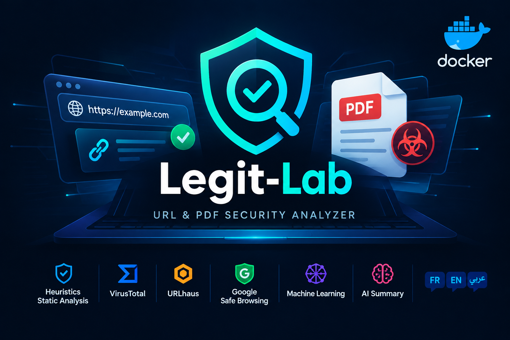

# Legit-Lab — Fast URL & PDF Security Analysis

<p align="center">

</p>

<p align="center">
<strong>Fast, accessible, open-source security triage.</strong>
<br>
Analyze suspicious URLs and PDF documents using static heuristics, machine learning, threat intelligence, and optional AI-powered reports.
</p>

<p align="center">
<a href="https://hub.docker.com/r/elouzi09/legit-lab">Docker Hub</a> ·
<a href="../../issues">Report a Bug</a> ·
<a href="../../issues">Request a Feature</a>
</p>

---

## Overview

**Legit-Lab** is an open-source cybersecurity tool designed to make everyday security triage faster and more accessible.

Analyze suspicious URLs and PDF files through multiple independent detection layers, inspect technical indicators, and generate clear, multilingual reports to help you understand potential threats.

The goal is simple: **identify suspicious behavior quickly, understand the evidence, and make better-informed security decisions.**

## Features

- **URL Analysis** — Detect suspicious URL patterns, potential typosquatting, raw IP addresses, unusual TLDs, homographs, and other indicators.
- **PDF Analysis** — Inspect JavaScript, automatic actions, launch actions, embedded files, and internal URLs.
- **Threat Intelligence** — Enrich findings with VirusTotal, URLhaus, and Google Safe Browsing when configured.
- **Machine Learning** — Estimate URL phishing risk using lexical features and a locally trained logistic regression model.
- **AI-Powered Reports** — Generate concise explanations using Gemini or DeepSeek, with automatic template-based summaries when AI is unavailable.
- **Multilingual Reports** — Available in French, English, and Arabic.
- **Independent Analysis Layers** — Compare static indicators, ML predictions, and external reputation results.
- **Flexible Configuration** — Core static analysis, ML predictions, and template-based reports work without API keys.
- **Docker Support** — Run the application in an isolated container without manually installing its Python dependencies.

## How It Works

Legit-Lab combines several analysis techniques to provide a more complete picture of potential risks.

| Analysis Layer | Purpose | API Key |
|---|---|---|
| Static heuristics | Identify suspicious URL and PDF characteristics | Not required |
| VirusTotal | Check available URL and file reputation information | Optional |
| URLhaus | Check known malicious URL intelligence | Optional |
| Google Safe Browsing | Check URL safety information | Optional |
| Machine learning | Estimate phishing risk for URLs | Not required |
| AI summaries | Explain findings in natural language | Optional |

Each layer provides different evidence. Results should be interpreted together rather than relying on a single verdict.

## Quick Start with Docker

### 1. Pull the image

```bash
docker pull elouzi09/legit-lab:latest
```

### 2. Start the application

```bash
docker run --rm -p 5000:5000 elouzi09/legit-lab:latest
```

### 3. Open the interface

Visit:

[http://localhost:5000](http://localhost:5000)

You can begin analyzing URLs and PDF documents without configuring external API keys.

## API Configuration

Legit-Lab supports five optional service integrations:

| Service | Purpose |
|---|---|
| VirusTotal | URL and file reputation checks |
| URLhaus (abuse.ch) | Malicious URL intelligence |
| Google Safe Browsing | URL safety checks |
| Google Gemini | AI-powered report summaries |
| DeepSeek | Alternative AI-powered summaries |

**All API integrations are optional.** Without API credentials, static heuristics, the locally trained ML model, and template-based reports remain available.

### Option 1 — Use `.env.example`

Copy the example configuration:

```bash
cp .env.example .env
```

Edit `.env` and enter the API keys you want to use. Leave unused keys empty.

Then launch the container:

```bash
docker run --rm -p 5000:5000 \
--env-file .env \
elouzi09/legit-lab:latest
```

Make sure `.env.example` contains the correct variable names and that `.env` is excluded from version control.

### Option 2 — Configure keys through the interface

Use the application's **API Settings** page to configure supported services.

According to the application configuration, keys entered through the interface take priority over environment variables. Interface-provided keys are stored in server memory for the browser session and are cleared when the container restarts.

### Option 3 — Pass environment variables directly

The following example illustrates the configuration pattern for the three explicitly documented variable names:

```bash
docker run --rm -p 5000:5000 \
-e VT_API_KEY="your_virustotal_key" \
-e GSB_API_KEY="your_safe_browsing_key" \
-e GEMINI_API_KEY="your_gemini_key" \
elouzi09/legit-lab:latest
```

For URLhaus and DeepSeek, use the exact variable names defined in `.env.example` and supported by the application.

**Never commit real API keys to GitHub or embed them in a published Docker image.** Use your own credentials and review each provider's data-handling policies before submitting URLs or files.

### Obtain API keys

- **VirusTotal:** https://www.virustotal.com/gui/my-apikey
- **URLhaus:** https://auth.abuse.ch/
- **Google Safe Browsing:** https://developers.google.com/safe-browsing/v4/get-started
- **Google Gemini:** https://aistudio.google.com/app/apikey
- **DeepSeek:** https://platform.deepseek.com/api_keys

Availability, quotas, and terms depend on each provider and may change.

## Example Workflow

1. Open the web interface.
2. Select French, English, or Arabic for the report.
3. Submit a URL or upload a PDF you are authorized to analyze.
4. Review the overall assessment and the individual detection indicators.
5. Compare local analysis results with available external reputation checks.
6. Read the generated summary and investigate suspicious findings further.

Reports can include a global verdict, triggered static indicators, external API results, URL phishing risk estimates, and a natural-language summary.

## Machine Learning: Important Limitations

The URL classification model is trained on a **synthetic dataset generated by project rules**, rather than a validated corpus of real-world phishing URLs.

This approach keeps the Docker build reproducible and avoids downloading a training dataset during the build. However, its predictions are experimental and should not be interpreted as calibrated probabilities of real-world phishing.

The model can produce false positives and false negatives. Its performance should be evaluated against representative, properly labeled datasets before being relied upon in operational environments.

To experiment with alternative datasets, review `data/url_dataset.csv`, `generate_dataset.py`, and `ml_model.py`. Use datasets only in accordance with their licenses and usage conditions.

## Roadmap

- [ ] Provide a documented REST API for integration with other security tools.
- [ ] Improve detection using validated real-world datasets.
- [ ] Expand report export and automation capabilities.
- [ ] Add automated tests and improve detection coverage.
- [ ] Explore integrations with security workflows and incident response platforms.
- [ ] Improve transparency around detection confidence, false positives, and false negatives.

The REST API is a **future enhancement**, not a feature advertised as currently available.

## Contributing

Legit-Lab is an open-source project, and contributions are welcome.

You can help by:

- Improving URL and PDF detection techniques.
- Adding analysis modules and threat intelligence integrations.
- Improving translations, documentation, and accessibility.
- Reporting bugs and suggesting new features.
- Adding tests and evaluating detection quality.
- Improving performance, reliability, and maintainability.

### How to contribute

1. Fork the repository.
2. Create a feature branch.
3. Implement and test your changes.
4. Commit your work with a clear message.
5. Open a pull request describing the change and its purpose.

Small improvements, detailed bug reports, and constructive suggestions are all valuable contributions.

## Security and Privacy

- **Local deployment:** The built-in Flask server is intended for local use or trusted networks. It does not provide application authentication by default.
- **Internet exposure:** Do not expose the development server directly to the public internet. Use appropriate authentication, HTTPS, and production deployment controls.
- **External services:** Depending on the integration, submitted indicators or files may be sent to third-party services. Avoid submitting confidential documents or sensitive URLs without authorization.
- **Temporary files:** Uploaded files are removed after analysis according to the application's documented workflow.
- **API credentials:** Keep secrets out of source code, Git history, Docker build layers, and public repositories.
---

<p align="center">
<strong>Built for faster security triage. Improved through open-source collaboration.</strong>
</p>
